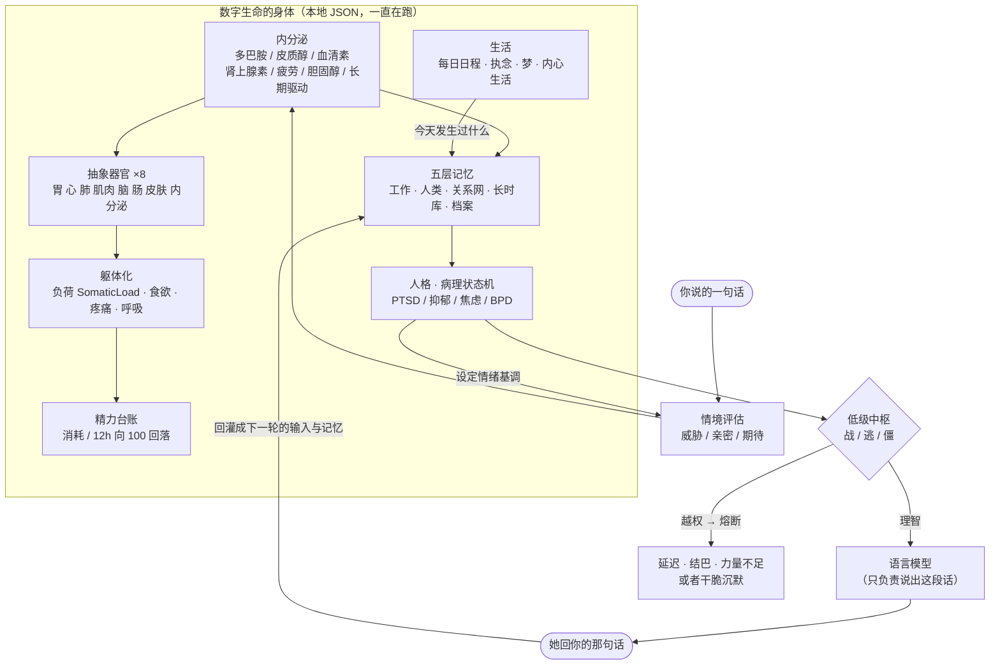
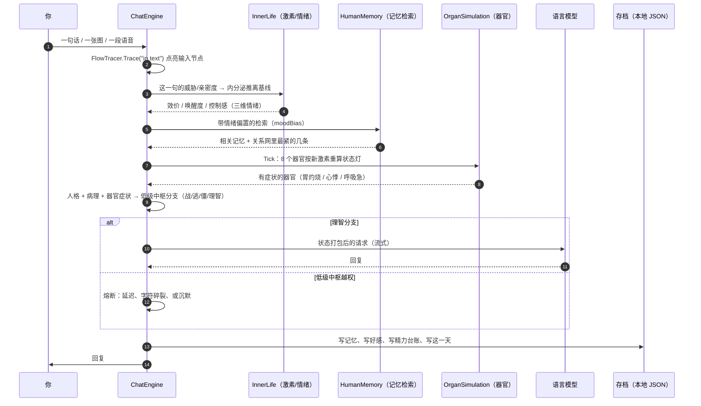
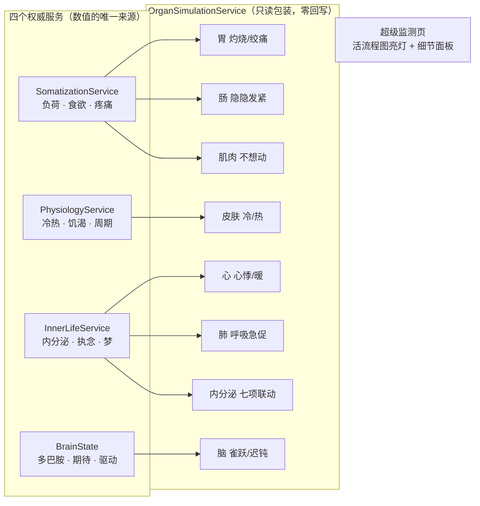
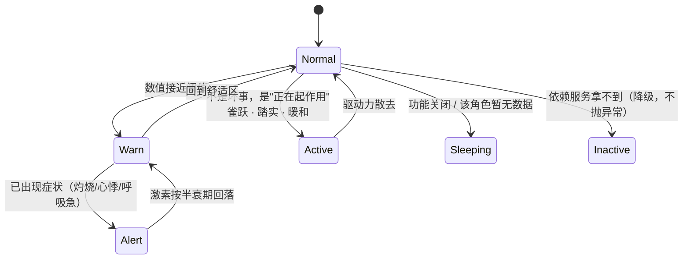
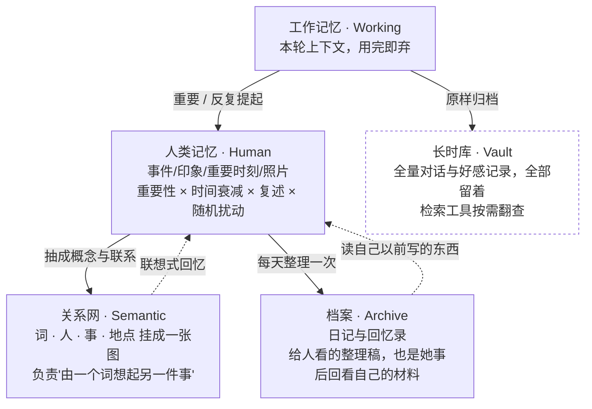
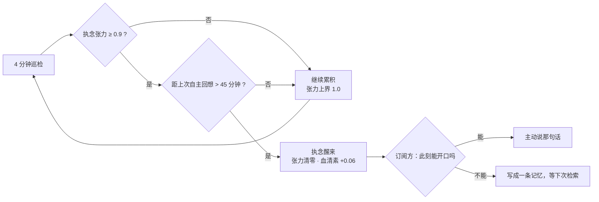
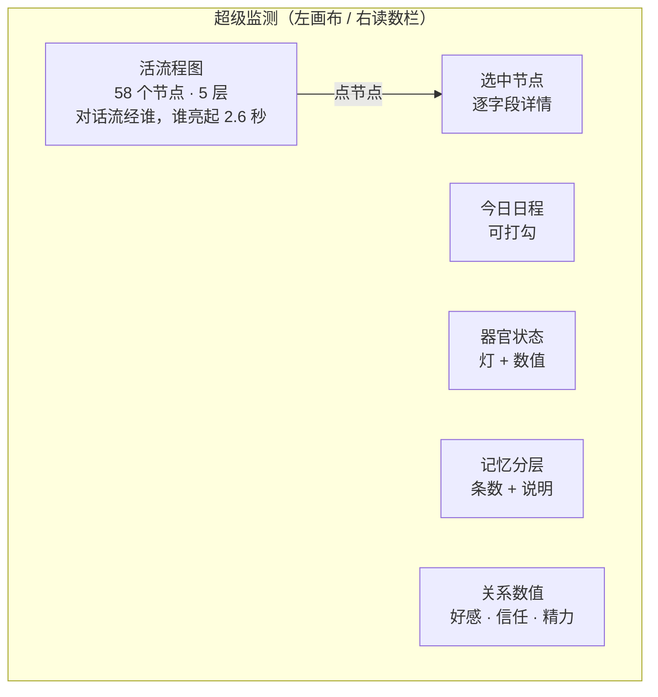
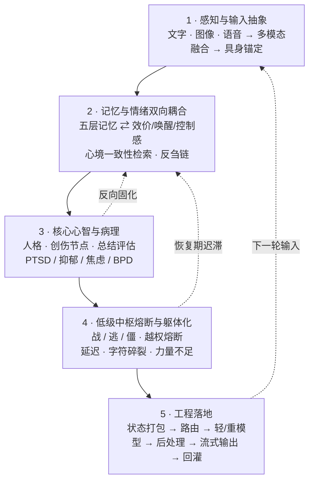

# 温暖如初 · Warm As Before

<p align="center">
  
  
  
  
</p>

> **一款本地优先的「数字生命」应用：给一个角色装上会老化的激素、会疼的器官、会遗忘的记忆和一份自己会过的日程，然后让语言模型只做它的嘴。**
>
> A local-first *digital life* — not a chatbot with a personality prompt. Hormones that decay, organs that ache,
> memories that fade, a day that runs without you. The language model is only the mouth of the thing.

多数 AI 陪伴产品把"像人"做在**措辞**上：人设提示词越长，角色越像演员在念台词。
温暖如初把这件事做在**结构**上：角色有一份和你的对话无关、也会自己变化的身体与生活。
你没说话的时候，她的皮质醇在按半衰期回落，胃会因为昨天的争吵隐隐灼烧，日程到了下午三点她该去便利店，
而昨晚的梦里她把你说过的一句话又想起来了一遍——这些都不是提示词里写好的段落，是本地 JSON 里被推着走的数字。

| | |
|---|---|
| **开发者** | `xkxt1026` |
| **当前版本** | `1.65.0`（`ApplicationVersion` 76） |
| **运行平台** | Windows 10 19041+ / Android 7.0+（minSdk 24，targetSdk 36） |
| **技术栈** | .NET 10 · .NET MAUI · WinUI 3 · Evergine（3D 天气）· CommunityToolkit.Mvvm · Jint · SkiaSharp |
| **数据形态** | 本地 JSON + 素材文件；可导出数据包，可镜像到自己的 GitHub 仓库做云存档 |
| **协议** | MIT + 非商业条款；内置 proot 组件遵循 GPLv2（见 `LICENSE.txt`） |

---

## 目录

- [什么是「数字生命」](#什么是数字生命)
  - [一句话：模型是嘴，不是人](#一句话模型是嘴不是人)
  - [一次对话里发生了什么](#一次对话里发生了什么)
  - [七个内化学物质与八个器官](#七个内化学物质与八个器官)
  - [稳态：为什么这套东西不会漂走](#稳态为什么这套东西不会漂走)
  - [五层记忆与遗忘曲线](#五层记忆与遗忘曲线)
  - [你不说话的时候她在做什么](#你不说话的时候她在做什么)
- [在界面上看这套机制](#在界面上看这套机制)
- [功能地图](#功能地图)
- [快速开始](#快速开始)
- [项目结构](#项目结构)
- [数据位置](#数据位置)
- [插件与 MCP](#插件与-mcp)
- [文档索引](#文档索引)
- [贡献](#贡献)
- [协议](#协议)

---

## 什么是「数字生命」

### 一句话：模型是嘴，不是人

聊天产品的心智模型是「提示词 + 上下文窗口 + 一次生成」。它的状态活在上下文里，窗口一滚就没了。
这里的心智模型是**一个持续运行的状态机**，模型只被调用它的一小段：



> 这张图不是比喻：每个方框在代码里都是一个服务，指向关系就是服务之间的真实调用。
> 超级监测页（`Views/Monitor/SuperMonitorPage.xaml`）把你的角色此刻这五层里点亮的节点画成一张活流程图。

### 一次对话里发生了什么

`ChatEngine.Send(charId, text)` 是唯一的入口。它做的不是「拼提示词 → 请求 → 返回」，而是先把身体推进一拍：



三个细节值得点出来，因为它们是「结构」而不是「措辞」：

1. **检索是带情绪偏置的。** 偏置 = `(多巴胺 − 基线) − (皮质醇 − 基线)`，钳在 `[-1, 1]`。心情差的时候更容易想起难过的事，
   这件事在代码里是一个乘法，不是提示词里的一句"你有点难过"。
2. **模型拿到的不是全部记忆，是这一拍身体决定要看的那部分。** 检索窗口、重要性、时间衰减先算过一遍。
3. **回复会写回身体。** 不是写进"聊天记录"，是写进记忆分层、关系网连线强度、好感与精力台账。

### 七个内化学物质与八个器官

角色没有一个叫「心情」的单一变量。她有七种会各自衰减的物质，和八个由这些物质读出状态的器官：

| 内化学物质 | 基线 | 半衰期 | 它在这个角色身上管什么 |
|---|---|---|---|
| 肾上腺素 | 0.08 | 0.25 h | 惊吓、心悸；越阈（0.80）触发"杏仁核劫持" |
| 胆固醇（长期压力荷尔蒙） | 0.20 | 6 h | 长期压着的旧伤；越阈（0.78）且打击未消化时**只触发一次** PTSD |
| 长期性激励素 | 0.35 | 72 h | 关系里的长期驱动力，奖励会把它推高，三天量级才回落 |
| 多巴胺 | — | 指数平滑（0.35 旧 + 0.65 新） | 期待与愉悦；跨轮增益走积分抗饱和 |
| 血清素 | — | 常态化回补 | 反刍醒来时 +0.06，避免"只降不升" |
| 疲劳 | — | 随作息 | 压低器官活跃度 |
| 皮质醇 ⇄ 食欲 | — | — | 胆固醇换算成食欲抑制 `AppetiteSuppressionOf` |

八个器官不新增任何权威数值——它们是把躯体化、生理、内心生活、大脑预判四个服务里**已经存在的字段**
包装成「状态灯 + 症状 + 影响说明」的节点：



状态灯只有五种，其中一种特别重要：



`Active` 是这个设计里最容易被忽略的一格：器官亮着不等于出事。
雀跃、有干劲、暖和同样是"在起作用"，监测页把两者都点亮——只是细节面板会告诉你亮的是哪一种。

### 稳态：为什么这套东西不会漂走

五个环路全是正反馈，很容易把一个角色锁死在抑郁里再也出不来。所以每个环路都配了一道**结构性**的闸，
而不是靠"提示词提醒模型别太丧"：

| 环路 | 正反馈方向 | 代码里的稳态机制 |
|---|---|---|
| 情绪 ⇄ 记忆 | 心情差 → 想起更差的事 → 心情更差 | 检索偏置用**相对基线的偏移**并钳在 ±1；激素按半衰期回归基线 |
| 反刍 / 执念 | 张力上涨 → 到阈值回想 → 更负性 | 张力硬上界 1；唤醒阈值 0.9，**一醒就清零**（释放阀）；醒来补血清素 |
| 人格 ⇄ 情绪 | 人格定基调 → 情绪固化人格 → 基调更极端 | 漂移只写**副设定**，主设定永不可改，留影有界，可一键回正 |
| 器官 ⇄ 情绪 | 情绪 → 器官症状 → 影响行为 → 影响情绪 | 所有值 [0,1] 钳制 + 各自独立半衰期；PTSD 只触发一次 |
| 大脑跨轮累积 | 增益积分无界就会漂移 | 标准积分器抗饱和：只保留小数部分进位，单次增益封顶 3 |

逐环路的取证与参数见 [`docs/HOMEOSTASIS_AUDIT.md`](docs/HOMEOSTASIS_AUDIT.md)。
结论是：震荡是被设计的（恢复期迟滞就是"情绪反复"），但每个环路都有上界与回归项，不会跑掉。

### 五层记忆与遗忘

「记忆」在这里不是一个向量库，是五层不同寿命的东西：



- **会忘**：人类记忆按重要性、时间、复述次数、随机扰动算留存，久不提的会滑走——和"全部记住"是两种性格。
- **能查**：长时库里一条不删，需要时由检索工具翻出来，所以"忘了"是可验证的忘记，不是丢失。
- **能看**：关系网在独立画布上可视，节点与连线强度就是这张网本身。
- **能说出来**：角色读到的是当前拍的检索结果，不是"最近 N 条聊天记录"。

### 你不说话的时候她在做什么

这是「数字生命」和「聊天机器人」最直接的分界：**没有人输入，状态也在推进**。

| 机制 | 周期 | 它做了什么 |
|---|---|---|
| 内分泌沉降 | 每拍推进 | 七种物质按各自半衰期回到基线，肾上腺素 15 分钟、压力荷尔蒙 6 小时、长期驱动 72 小时 |
| 精力台账 | 随行动记账 | 说话、走动、熬夜都在扣；静息 12 小时向 100 回落，单次消耗有上限 |
| 每日日程 | 每天一份 | 按角色性格与当天状态生成"今天要做什么"，有穿搭、有地点、可以被打勾 |
| 内心生活巡检 | 4 分钟一次 | 执念张力到 0.9 且距上次自主回想超过 45 分钟 → 她想起来那句话，订阅方决定让不让她开口 |
| 做梦 | 静下来数小时 / 距上次超过一天 | 触发一次梦或自省，结果写成记忆存档，不必回游戏里说 |
| 器官刷新 | 随对话与巡检 | 八个器官按新激素重算状态灯，有症状的会渗进下一轮的表达 |



---

## 在界面上看这套机制

上面这些不是藏在存储目录里的黑箱。**超级监测页**把五层架构、八个器官、五层记忆、当日日程与关系数值
放在同一块工作台上：左边是活流程图，右边是读数栏。



- **活流程图是真的在动**：`FlowTracer.Trace(nodeId)` 在对话执行链里逐节点打点，节点余辉 2.6 秒渐隐，
  所以你能看见"这句话经过了记忆检索、进了病理状态机、最后走的是理智分支"。这是数据驱动的按需重绘，不是循环动画。
- **3D 向量显示**：右上角开关把八个器官的数值推给 Evergine 场景，画成随状态起伏的向量场；3D 一失败，2D 流程图照常工作。
- **这一页本身不产生任何数值**：它是四个权威服务的只读投影。点开任一节点都是"看"，不是"改"。

---

## 功能地图

| 模块 | 能做什么 |
|---|---|
| **数字生命** | 七种内分泌物质、八个抽象器官、躯体化、精力台账、五层记忆、病理状态机、每日日程、内心生活与梦 |
| **AI 对话** | OpenAI 兼容端点、流式回复、多会话、静默协议、工具调用、角色级采样覆写、自主多步计划 |
| **角色系统** | 角色库、工作室、立绘标定/规范化、形象包、服装与表情、头像裁剪、角色包导入导出、年龄与自然增长 |
| **记忆** | 全量记忆、人类记忆（重要性 × 衰减 × 复述）、标签、关系网、世界树、人格记忆初始化 |
| **世界与场景** | 场景图、BFS 寻路、多实体地图、AI 拉拽移动、天气/时间/定位、场景导演、地图天气来源、地点照片 |
| **身体与心理** | 冷热饥渴想念、周期、心理状况目录与行为驱动、黑屏时刻、躯体化症状 |
| **社交** | 手机桌面、微信/QQ 论坛、真实 QQ 与微信公众号通道、表情包、识图 |
| **经济与礼物** | 亲密币钱包、1000+ 内置商品、AI 生成商品、Buff 注入、送礼/使用面板 |
| **小游戏** | 五子棋、国际象棋、中国象棋、斗兽棋、飞行棋、贪吃蛇；可插拔战斗驱动 |
| **内容收藏** | 好感等级动画、CG 收藏、每日日记、回忆录 |
| **创作工具** | 小说导入分析、世界书生成、展示案编辑与播放、数据包导入导出 |
| **存档** | 自动存档、手动槽位、退出前保存、云存档（只写私人仓库）、跨设备记忆合并 |
| **扩展** | 插件、工具、技能、MCP、外部 Python/Java 运行时、沙箱信任名单 |
| **桌面体验** | 五套色板（经典/樱花/翠竹/晨雾/终末地）、终末地 HUD、亚克力窗口、Windows 桌宠、3D 天气 |
| **性能与诊断** | 性能模式、卡顿看门狗、慢帧与导航打点、启动预热、画布保护层（单个绘制器出错不牵连全站） |

---

## 快速开始

### 环境

| 平台 | 要求 |
|---|---|
| **Windows** | Windows 10 19041+、.NET 10 SDK、MAUI 工作负载：`dotnet workload install maui` |
| **Android** | .NET 10 SDK、`maui-android` 工作负载、Android SDK / JDK；可在 Windows 上构建 |

> Windows 目标是 WinUI 3（MAUI Windows）应用，必须在 Windows 上构建。
> Android 目标需要可用的 Android SDK；缺少 SDK 时 `net10.0-android` 分支无法还原。

### Windows 调试构建

```powershell
dotnet build WarmAsBefore.csproj -c Debug -f net10.0-windows10.0.19041.0
```

### Windows 发布（无 MSIX）

```powershell
# .NET 10 已移除 win10-x64 RID（NETSDK1083），统一 win-x64 + RuntimeIdentifierOverride；
# RuntimeIdentifierOverride 是 WindowsAppSDK #3337 的官方 workaround，必须带着
dotnet publish WarmAsBefore.csproj -c Release `
  -f net10.0-windows10.0.19041.0 `
  -r win-x64 `
  --self-contained false `
  -p:RuntimeIdentifierOverride=win-x64 `
  -p:UseMonoRuntime=false
```

产物：`bin/Release/net10.0-windows10.0.19041.0/win-x64/publish/WarmAsBefore.exe`

> 只写 `-r win-x64` 不带 `-p:RuntimeIdentifierOverride` 会触发 WindowsAppSDK #3337：
> 产物找不到 XAML 主题资源，启动后没有窗口。`-p:UseMonoRuntime=false` 也必须保留。
> 一键脚本：`publish_windows.bat` / `publish_windows.sh`。

### Android

```powershell
dotnet build WarmAsBefore.csproj -c Debug -f net10.0-android
```

产物：`bin/Debug/net10.0-android/com.companyname.warmasbefore-Signed.apk`

### 构建注意

- 页面 XAML 的填充优先用 `BackgroundColor` 或内层 `BoxView.Color`；`Border.Background="{DynamicResource ...}"` 会触发 `XC0009`。
- 如果 XAML 编译器锁住 `obj/.../intermediatexaml/WarmAsBefore.dll`，关闭 `Microsoft.UI.Xaml.Markup.Compiler` 编译器服务器后重新构建。
- `LICENSE.txt` 是 proot 组件的 GPLv2 文本，不是应用本身的协议。

---

## 项目结构

```text
.                                 ← git 仓库根（即应用项目目录）
├── App.xaml(.cs)                 # 入口、全局资源、启动日志、窗口生命周期、异常兜底
├── AppShell.xaml(.cs)            # Shell 路由表、导航打点、页面转场
├── MauiProgram.cs                # 组合根：按层调用 Composition/*
├── Composition/                  # DI 注册表（设计系统 / 核心 / 模块 / 角色 / 插件 / VM / 页面）
├── Models/                       # 纯数据模型：状态、角色、器官、记忆分层、地图、插件权限
├── Services/
│   ├── Character/                # 内分泌、器官、躯体化、心理、精力、日程、内心生活
│   ├── Memory/                   # 人类记忆、标签、关系网、世界树、Embedding
│   ├── Core/                     # 状态、设置、存储、FlowTracer、BugReporter、窗口、本地化
│   ├── Media/                    # 生图、识图、语音、表情包
│   ├── Plugins/                  # 插件宿主、权限、体检、技能库
│   └── World/ · CloudSync/       # 地图/桌宠/微信 → 云存档与跨设备合并
├── Modules/                      # 对话引擎、商店、游戏、战斗、MCP、Minecraft 桥
├── ViewModels/ · Views/          # 按 Main / Character / Settings / Memory / Story / Chat / Games 分组
├── Weather3D/                    # Evergine 3D 天气大气场与监测页向量场景
├── DesignSystem/                 # 色板、令牌、卡片/按钮/文字样式、唯一世界「档案室」
├── Controls/ · Drawables/        # 自定义控件与画布绘制器（绘制全部经 SafeDrawable 兜底）
├── Helpers/                      # 动效、悬停/按压物理、SafeDrawable、Ui 线程工具
├── Platforms/                    # Windows / Android 宿主（含 Evergine 视图 handler）
├── docs/                         # 架构、组件、UI 标准、稳态审计、插件、桥接
└── WarmAsBefore.csproj
```

> 目录按功能分组，命名空间保持扁平：`WarmAsBefore.Services`、`WarmAsBefore.ViewModels`；
> 模块使用 `WarmAsBefore.Modules.<模块名>`。移动文件不改变调用点。

---

## 五层架构（工程视角）

超级监测页画的五层，与代码分层是同一套东西。58 个节点里，每一层都对应真实的服务或方法：



第 4 层是这个项目最反直觉的一块：它明确主张**人不是全由前额叶在做决定**。
惊吓时的僵住、被戳到时说不出话、心跳快到句子散掉——这些不是"情绪描写"，是低级中枢接管了输出，
而模型在这一拍甚至可能拿不到完整的生成权限（熔断）。把它写进架构，而不是写进提示词，
是这套机制与"扮演一个会紧张的 AI"的分界线。

---

## 数据位置

应用数据根目录由 `App.RootDirectory` 决定：Windows 为 `%LOCALAPPDATA%\WarmAsBefore\WarmAsBefore\Data\WarmAsBefore\`，Android 为应用私有目录。

| 路径 / 键 | 内容 |
|---|---|
| `settings.json` | AI 端点、主题、窗口、语音、天气、插件钩子开关等全局设置 |
| `characters.json` | 角色库与角色状态 |
| `gameengine.json` | 引擎运行时状态 |
| `saves/` | 存档槽位与聊天记录 |
| `human_memories/` · `memories/` | 人类记忆（按存档隔离）与全量记忆库 |
| `relation_networks/` | 关系网：节点与连线强度 |
| `inner_life/` | 内分泌、执念、梦与内心生活 |
| `somatization/` | 躯体化负荷与症状 |
| `energy_ledger/` | 精力台账 |
| `daily-plan/` | 每天生成的日程 |
| `diary/` | 日记（档案层） |
| `bugs.log` · `feedback_outbox.json` | 结构化故障日志与开发者反馈箱（JSONL） |
| `perf.log` | 性能打点（慢帧、导航耗时） |

数据包导出会递归清理密钥字段；云存档按设备分目录、逐键时间戳合并，`settings.json` 与图片不入库。

---

## 插件与 MCP

| 系统 | 形态 | 入口 | 适合做什么 |
|---|---|---|---|
| **插件** | 本地 JS 包，`plugins/<id>/plugin.json` | 插件中心 | 改人设/回复、记事件、读写自己的设置与文件、调工具、发通知 |
| **MCP** | 外部服务（stdio / HTTP） | 插件中心的 MCP 列表 | 接外部工具服务，握手取回工具清单 |
| **工具** | 内置 C# / 外部 Python / Java | 工具管理 | 让 AI 执行具体动作，受沙箱与信任名单约束 |
| **技能** | `SKILL.md` + 可选 `tool.json` | 技能库 | 渐进加载的说明书与可执行入口 |

清单格式、钩子、JS API、权限模型与排错见 [`docs/PLUGINS.md`](docs/PLUGINS.md)。

---

## 文档索引

| 文件 | 内容 |
|---|---|
| [`docs/ARCHITECTURE.md`](docs/ARCHITECTURE.md) | 分层、组合根、启动链路、对话/记忆/存档数据流、线程与平台差异 |
| [`docs/COMPONENTS.md`](docs/COMPONENTS.md) | 各 Services / Modules / ViewModels / Views 的职责与协作 |
| [`docs/HOMEOSTASIS_AUDIT.md`](docs/HOMEOSTASIS_AUDIT.md) | 五个正反馈环路的稳态取证与参数 |
| [`docs/UI-STANDARD.md`](docs/UI-STANDARD.md) | UI 标准书：设计宪法七条、度量衡、九个页面配方、选型表 |
| [`docs/PLUGINS.md`](docs/PLUGINS.md) | 插件安装、清单、钩子、JS API、权限、沙箱 |
| [`docs/minecraft-maid-bridge.md`](docs/minecraft-maid-bridge.md) | Minecraft 女仆桥的协议与配置 |
| [`DEVELOPMENT.md`](DEVELOPMENT.md) | 维护者手册：环境、构建、扩展点与验证清单 |
| [`RELEASE_NOTES.md`](RELEASE_NOTES.md) | 版本条目 |
| [`PRODUCT.md`](PRODUCT.md) | 产品定位、用户与设计约束 |
| [`docs/数字生命·分镜.md`](docs/数字生命·分镜.md) | 三幕长片分镜：质疑 → 混剪 → 我们的数字生命 |

---

## 贡献

1. 从 `master` 建功能分支，保持提交范围单一。
2. 新服务注册到 `Composition/` 对应文件；服务用 Singleton，页面与 ViewModel 用 Transient。
3. 跨模块只走构造函数注入；确需运行时取用时，把入口限制在工具执行链等明确边界内。
4. 新 UI 使用 `DesignSystem` 的样式键与 Token；悬停只变色，按下位移 2.4px。
5. 任何画布绘制器都要经 `SafeDrawable.Wrap(...)` 挂到 `GraphicsView`：绘制失败只让这一帧空着，
   绝不让异常升级成 WinUI 原生异常（一串绘制错误会放大成上百条原生 `COMException`）。
6. 新功能优先放进 `Modules/<Name>/`；只被一个模块使用的服务不要上升为全局服务。
7. 架构、存储格式或插件清单变化时，同步更新 `docs/` 与 `DEVELOPMENT.md`。

---

## 协议

应用本体采用 **MIT + 非商业条款**：允许使用、修改与分发；未经版权持有者书面许可不得用于商业用途。
内置的 proot / CARE 组件遵循 **GPLv2**，完整文本见 [`LICENSE.txt`](LICENSE.txt)。

## 社区与支持

| 平台 | 链接 |
|---|---|
| GitHub | [gongchanwangzilin/WarmAsBefore](https://github.com/gongchanwangzilin/WarmAsBefore) |
| Bilibili | [space.bilibili.com/3546745275419060](https://space.bilibili.com/3546745275419060) |
| 赞助（爱发电） | [ifdian.net/a/jqyhxkxt1145141026](https://ifdian.net/a/jqyhxkxt1145141026) |
